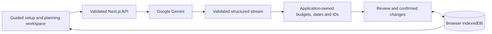

<div align="center">

# EventGenie AI

**Make room for the celebration.**

AI-assisted planning for weddings, birthdays, and community events.<br />
Turn your ideas into a practical plan, then manage the details with confidence.

[](https://github.com/SUJALMU2004/eventgenie/actions/workflows/quality.yml)

[Get started](#getting-started) · [Features](#features) · [Architecture](#architecture) · [Documentation](#documentation)

</div>

---

EventGenie brings budgets, preparation tasks, vendor decisions, event-day schedules, and invitations into one workspace. Google Gemini generates structured suggestions; application code handles financial calculations, dates, identifiers, and approved changes.

Plans stay in your browser. No account is required, and clearly labelled sample experiences let you explore the application without an API key.

## Features

| Capability                   | What you can do                                                                                                                   |
| ---------------------------- | --------------------------------------------------------------------------------------------------------------------------------- |
| **Personalised event plans** | Use a four-step wizard to create a blueprint tailored to your event, guest count, budget, priorities, and preferences.            |
| **Exact budget planning**    | Allocate spending with a configurable contingency, track quoted, committed, and paid amounts separately, and compare known costs. |
| **What-if scenarios**        | Preview budget and attendance changes, save alternatives, and compare up to three strategies alongside your current plan.         |
| **Vendor decisions**         | Organise your own supplier options, compare quotes, and record shortlist, booking, and checklist status.                          |
| **Tasks and readiness**      | Track preparation deadlines, dependencies, blockers, and outstanding decisions with explainable findings.                         |
| **Event-day schedules**      | Edit running orders with time windows, supplier/task links, keyboard move controls, and conflict validation.                      |
| **Contingency planning**     | Explore rain, supplier cancellation, cost increases, budget reductions, attendance changes, and delayed tasks.                    |
| **Plan-aware AI assistance** | Ask questions about your plan and review suggested tasks, ideas, schedules, or section refinements before applying them.          |
| **Invitation Studio**        | Create and edit drafts in five tones, personalise local event details, and copy, download, or share them yourself.                |
| **History and portability**  | Undo and redo saved changes, reopen plans, export JSON backups and calendars, and print saved planning details.                   |

**Supported events:** weddings, birthdays, and community celebrations.

**Currencies:** INR, USD, EUR, GBP, and JPY, with currency-specific precision and no exchange-rate conversion.

Vendor suggestions are planning categories, not verified business listings. Budget allocations are estimates; invitation delivery and payment processing are outside the application.

## Getting started

### Prerequisites

- Node.js **24.x** and npm.
- A Gemini API key for AI generation. Samples and local planning tools work without one.

### Install

```sh
git clone https://github.com/SUJALMU2004/eventgenie.git
cd eventgenie
npm ci
```

### Configure

Create `.env.local` from [.env.example](.env.example) if you do not already have a local environment file. In PowerShell:

```powershell
if (!(Test-Path .env.local)) { Copy-Item .env.example .env.local }
```

| Variable                       | Description                                                     |
| ------------------------------ | --------------------------------------------------------------- |
| `GOOGLE_GENERATIVE_AI_API_KEY` | Your server-side Gemini API key. Required only for AI requests. |
| `GEMINI_MODEL`                 | Server-side model setting. Defaults to `gemini-3.5-flash-lite`. |

Keep credentials in `.env.local`; never commit them or expose them through `NEXT_PUBLIC_*` variables. Model access, quotas, and billing depend on your Google project.

### Run

```sh
npm run dev
```

Open **[localhost:3000](http://localhost:3000)**. Choose an event type to begin, or select a labelled sample plan to explore without calling Google.

For a local production preview:

```sh
npm run build
npm start
```

## Planning workflow

1. **Describe the celebration.** Enter the essentials, spending priorities, and preferences.
2. **Review your blueprint.** AI streams validated previews while preparing the complete plan, or you can choose a sample.
3. **Make practical decisions.** Use the Decision Studio for costs, suppliers, preparation, and the running order.
4. **Explore alternatives.** Open advanced planning to compare strategies, prepare contingencies, and refine tasks or invitations.
5. **Keep control.** Confirm changes, undo saved edits, and export a backup when you need one.

## Architecture



The AI integration uses the direct Google provider through `@ai-sdk/google`, with `streamText`, structured output, and typed NDJSON. Complete results pass shared schemas before saving. Local calculations answer exact financial questions, and relevant validated AI results can be reused from the owning plan's browser cache.

| Layer             | Technology                                                            |
| ----------------- | --------------------------------------------------------------------- |
| Application       | Next.js App Router, React, strict TypeScript                          |
| Interface         | Tailwind CSS, Lucide, Radix Slot-based controls                       |
| AI and validation | AI SDK, Google Gemini, Zod                                            |
| Persistence       | Versioned IndexedDB with atomic workspace transactions                |
| Quality           | ESLint, Prettier, Vitest, React Testing Library, Playwright, axe-core |

```text
src/
  app/           Pages, layouts, and API routes
  components/    Shared interface controls
  features/      Setup wizard, dashboard, and planning tools
  data/          Event templates and labelled sample data
  schemas/       Shared input, output, and storage contracts
  lib/
    ai/          Prompts, provider adapter, validation, and streaming
    planning/    Finance, readiness, schedule, and contingency rules
    storage/     IndexedDB connections, records, and workspace commands
tests/e2e/       Production browser journeys and accessibility checks
docs/            Product and engineering documentation
scripts/         Repository size and credential checks
```

See [architecture and trust boundaries](docs/architecture.md) for module responsibilities and [AI integration](docs/ai-integration.md) for endpoint contracts.

## Privacy and reliability

- Plans, quotes, optional vendor contacts, and checklist progress remain in the current browser. Clearing browser data can remove them; JSON backups provide a portable copy.
- Initial AI generation sends the requirements you submit to Google. Follow-up operations send only the relevant bounded context. Avoid sensitive information in notes, questions, and preferences.
- Google's unpaid API terms permit product-improvement use of submitted content. Review the [Gemini API terms](https://ai.google.dev/gemini-api/terms) before supplying personal data.
- AI proposals require review. Money, final IDs, deadlines, completion state, and saved changes remain under application control.
- Failed requests preserve your inputs. Cancellation, bounded retries, explicit errors, and sample alternatives support recovery.

Read the [privacy and storage guide](docs/privacy-and-storage.md) and [security policy](SECURITY.md) for details.

## Development and testing

```sh
npm run format:check
npm run lint
npm run typecheck
npm run test:coverage
npm run build
npx playwright install chromium
npm run test:e2e
npm run security:check
npm run security:bundle
npm run audit
npm run size:check
```

Tests and builds work without a Gemini key. Browser tests use a dedicated production server on port **3100**. CI runs the same quality gates on pull requests and pushes to `main`; it does not deploy the application.

The latest verified functional release passed **562 automated tests and 33 Chromium cases**, with **98.92% statement coverage** across core modules. See the [verification record](docs/verification.md) for all coverage measures, the recorded CI run, and the limits of automated accessibility and provider checks.

## Documentation

| Guide                                              | Contents                                                        |
| -------------------------------------------------- | --------------------------------------------------------------- |
| [Product guide](docs/product-guide.md)             | Planning tools, workflows, and practical limits                 |
| [Architecture](docs/architecture.md)               | Components, data flow, contracts, and trust boundaries          |
| [AI integration](docs/ai-integration.md)           | Operations, streaming, caching, validation, and errors          |
| [Privacy and storage](docs/privacy-and-storage.md) | Local records, history, backups, and data sent to Google        |
| [Deployment](docs/deployment.md)                   | Runtime requirements, proxy configuration, and abuse protection |
| [Verification](docs/verification.md)               | Test results, coverage, performance, and verification scope     |
| [Evaluation evidence](docs/evaluation.md)          | Criteria mapped to implementation and executable checks         |
| [Contributing](CONTRIBUTING.md)                    | Development conventions and pull request checks                 |
| [Security](SECURITY.md)                            | Security boundaries and responsible reporting                   |
