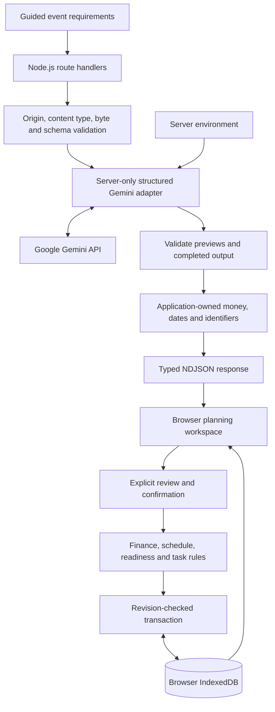

# Architecture

EventGenie is a Next.js application with browser-owned persistence, deterministic planning rules, and a server-only Google Gemini integration. The interface proposes changes; shared domain logic validates them before an atomic workspace commit.

## System overview

## Code organisation

| Area                            | Responsibility                                                                                                  |
| ------------------------------- | --------------------------------------------------------------------------------------------------------------- |
| `src/app`                       | Pages, shared layout, privacy copy, and three Node.js API entry points                                          |
| `src/components/ui`             | Semantic controls and the shared native confirmation dialog                                                     |
| `src/features`                  | Setup, dashboard, decision tools, and focused interaction hooks                                                 |
| `src/data`                      | Event-specific weights, vendor categories, task defaults, and labelled samples                                  |
| `src/schemas`                   | Strict event, output, finance, schedule, intelligence, and storage contracts                                    |
| `src/features/budget/engine.ts` | Currency precision, decimal parsing, formatting, and integer allocation                                         |
| `src/lib/planning`              | Financial positions, scenarios, recovery, dependencies, readiness, schedules, contingencies, and task mutations |
| `src/lib/ai`                    | Minimized context, trusted prompts, provider integration, output validation, streaming, and cache contracts     |
| `src/lib/storage`               | Database infrastructure, record decoding, repository facade, and atomic workspace commands                      |
| `src/lib/history.ts`            | Bounded snapshots, undo/redo, and revision invariants                                                           |
| `src/lib/portability.ts`        | Validated backups, import ID remapping, and calendar export                                                     |
| `tests/e2e`                     | Production browser journeys, responsive checks, and axe scans                                                   |

### Storage boundary

`repository.ts` preserves the public `PlanRepository` contract and composes `database.ts`, `record-store.ts`, `workspace-store.ts`, and `plan-store.ts`. Contracts, failures, envelope validation, and optional revision notifications have separate modules.

Workspace changes read and write plans, event requirements, enhancements, and history in one readwrite transaction. Expected revisions are checked inside that transaction. Validation failures abort all writes. Cross-tab notifications contain only plan ID, revision, and a random source identifier; their failure cannot undo a completed save.

The database remains `eventgenie-local-v1`, version **3**. Existing records receive additive defaults when needed, with no destructive reset. See [privacy and storage](privacy-and-storage.md) for record versions, history, and recovery behavior.

### AI boundary

Initial plans, targeted refinements, and contextual assistance share `structured.ts`, `http-stream.ts`, and `ndjson-client.ts`. Intelligence context, input validation, normalization, prompts, samples, and identity each have focused modules; `intelligence.ts` provides compatibility exports.

The provider receives trusted system instructions separately from bounded JSON data and exposes no executable tools. Full schemas validate complete results after provider-friendly structured decoding. Financial arithmetic, final IDs, deadlines, completion states, and approved mutations remain application-owned. See [AI integration](ai-integration.md).

### Interface boundary

Rendering components are separated from request/cache/acceptance controllers such as `use-plan-operation.ts`. Contingency rule handlers and controls have separate modules. Schedule activity editing, proposal review, and dashboard presentation use focused components.

`FieldValidationError` and shared form feedback map domain/Zod paths to visible descriptions and focus targets. Schedule validation preserves original editable-row indexes when sorting times. Native confirmations describe consequences, announce pending saves, retain failed actions, and restore focus when cancelled.

## Deterministic rules

- Money is stored in integer minor units. Largest-remainder rounding gives exact allocation totals with stable category-order ties. Selected priorities adjust weights; contingency is explicit and defaults to 10%.
- Quotes, commitments, and paid amounts are distinct. Protected supplier cost is the greater of a booked commitment and its linked payments; unlinked payments are added once. Scenario minima include those costs without double-counting deposits.
- Dates are ISO date-only values. UTC date arithmetic avoids daylight-saving shifts; the planning clock uses Asia/Kolkata and is injectable in tests. Historical plans stay readable.
- Dependencies use bounded graph traversal with cycle and ownership checks. Readiness reports explicit findings rather than an invented percentage.
- Schedule validation checks positive durations, unique IDs, valid links, window containment, overlap, and event-specific order. Overnight windows are not supported.

## Runtime and performance

The landing, library, privacy, and not-found pages are statically rendered. Setup and saved-plan routes render on demand. The wizard loads the dashboard lazily; advanced planning loads only when opened. Server routes are stateless and retain no event database or filesystem records.

Validated repeated AI operations reuse versioned, plan-owned local caches. Typing, rendering, sliders, and deterministic calculations do not call Google. Request deadlines, output caps, one bounded transient retry, and cancellation limit wasted work. No heavy chart library or external font download is required.

## Engineering standards

Strict TypeScript includes unused-code, implicit-return, and switch-fallthrough checks. Type-aware ESLint checks promises, type-only imports, and unnecessary assertions, with source function complexity limited to 15. Coverage includes all library, schema, and budget modules with four 80% thresholds. The [verification record](verification.md) links measured results and the complete CI workflow.
