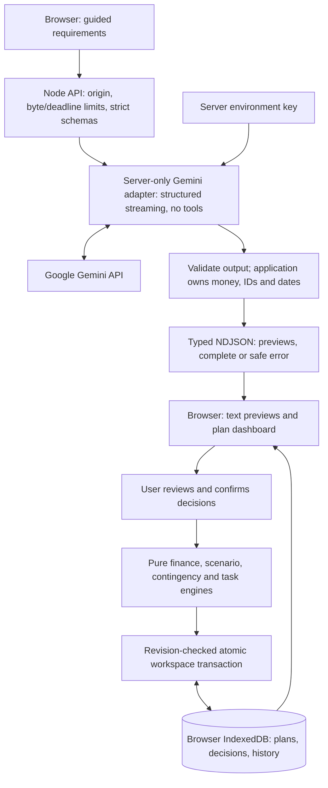

# Architecture and trust boundaries

## Current release

Phase 4 retains the architecture and database version **3**. It strengthens shared transport deadlines/finalization, post-commit notification isolation, accessible controls and release tooling. See [the audit](phase4-audit.md) and [evaluation matrix](phase4-evaluation-matrix.md) for measured evidence. This repository contains no deployment workflow and must not be linked or deployed to Vercel under the current authorization.



```text
src/app/                    routes, layouts and API entry points
src/features/               wizard, dashboard and focused decision panels
src/components/ui/          shared semantic controls and native confirmation
src/data/                   deterministic event/vendor/demo templates
src/schemas/                reusable event, plan, financial and AI contracts
src/lib/planning/           financial and event-planning algorithms
src/lib/ai/                 prompts, provider adapter, streams and local-cache contracts
src/lib/storage/            IndexedDB repository and additive migrations
src/lib/history.ts          bounded snapshots, undo/redo and revision invariants
tests/e2e/                  full event journeys, axe and release browser checks
scripts/                    tracked-size and source/index/history/bundle credential checks
docs/                       architecture, evaluation evidence and release instructions
```

## Preserved implementation history

Phase 3 adds [shared transactional history and plan-specific intelligence](phase3.md). The current database version is **3**, adding only the history store to the Phase 2 stores. Original plan/event/draft envelopes stay at version 1, enhancements at version 2, with optional version-3 intelligence data. Version-3 streaming serves `/api/plans/intelligence`; earlier stream contracts remain supported. The paragraphs below describe the preserved foundation and its historical Phase 2 extension.

Phase 2 extended this architecture through [the Decision Studio design](phase2.md). Its historical upgrade introduced database version 2 and the owned enhancements store; Phase 3 subsequently added history at version 3. Plan/event/draft envelopes remain version 1. Shared structured-generation and NDJSON modules serve the original endpoint and targeted operations.

## Product boundary

EventGenie is a domain-specific planning product, not a general chatbot. A guided requirements form feeds one structured AI request. Weddings, birthdays and community events have different budgets, essential tasks and vendor templates. Advanced guest/payment management and conversational AI are outside Phase 1.

## Data contracts

- `EventInput`: event type, title/subtype, ISO date, city, bounded integer guests, integer `budgetMinor`, currency, style/setting, food/cultural preferences, up to three spending priorities, requirements and notes.
- `Recommendations`: overview, category explanations, 12–20 tasks with relative day offsets, 3–10 vendor categories with booking offsets, 4–6 ideas, 1–2 invitation drafts and warnings. The model does not own monetary amounts or final IDs.
- `EventPlan`: version 1 record with UUID, timestamp, input fingerprint, explicit `ai`/`demo` source, validated requirements, deterministic allocations, dated/identified checklists and recommendations.
- `StreamMessage`: discriminated `preview`, `complete` or `error` NDJSON frames. Every network frame is validated on the client. An interrupted stream never becomes a saved plan.
- `PlanRepository`: save event/plan, load/list/delete plans, atomic task/vendor updates, draft save/load/clear and local AI-result lookup.

## Browser → server

All event input is untrusted. The server checks method, content type, actual byte count (not merely Content-Length), browser origin context and strict input constraints before contacting Gemini. New generation requires a future date; stored records intentionally do not enforce that temporal rule. Origin checks reduce browser misuse but cannot authenticate curl or stop distributed abuse.

## Server → Gemini

Only the server-only provider imports `@ai-sdk/google`. The key configures the HTTP provider and is never supplied as prompt content. The system prompt controls domain behaviour; serialized event data remains untrusted requirements. No tools execute user-controlled instructions, and no search or paid gateway is involved. Bounded prompts and output tokens constrain compute.

The SDK's `partialOutputStream` yields partial objects. Individual section schemas filter incomplete fields; previews are never written to IndexedDB. After SDK completion, the recommendations schema is checked again and normalisation assigns IDs, dates, default checklist status and integer allocations. Budget totals and duplicate IDs are checked by the durable schema.

Provider failure before response setup uses non-2xx JSON. Failures during a 200 streaming response use terminal error frames, since headers cannot change after transmission starts. Error translation exposes safe codes and actions. Cancellation and a 90-second timeout reach the upstream provider. Automatic retries stop after one attempt or any delivered preview; long Retry-After hints are returned to the user.

## Browser persistence

IndexedDB object stores separate plans, events and drafts. Plan/event writes are transactional. Checklist updates read and write inside one readwrite transaction, avoiding last-writer loss for concurrent updates. Version 1 envelopes are validated on read. Unknown versions are preserved and reported; invalid records are skipped in lists with visible issues. There are no destructive speculative migrations.

An unavailable/full database never causes a false “saved” message. A completed plan can remain in tab memory and be retried. There is no cross-device sync or recovery after clearing browser data. SHA-256 fingerprints support browser-local reuse; samples are excluded. Fingerprint version changes invalidate reuse when prompt/budget semantics change.

## Arithmetic and dates

Decimal input becomes integer minor units without floating-point monetary multiplication. All supported budgets and intermediate products stay within JavaScript's safe integer range. Rounded contingency is reserved first. Priority-adjusted category weights receive the remaining amount using largest-remainder allocation and a stable category-order tie-break.

Date-only arithmetic runs in UTC to avoid daylight-saving issues. Asia/Kolkata defines today for the India-first experience. Past preparation deadlines move to the planning start with a short-preparation warning; tasks never move beyond the event date during normalisation.

## Deployment and security

Next.js pages use server rendering by default and client components only for interaction/storage. The wizard dynamically imports the dashboard. Static templates and an original SVG illustration keep the source small. The Node route is stateless; there is no server filesystem/database persistence or per-process rate-limit Map.

A manually configured Vercel WAF rule supplies deployment-level per-IP throttling. Counters are regional, shared IPs can affect legitimate groups, and Google project quotas remain global external constraints. Security headers and text rendering reduce common browser attack paths. Prompt separation and schema checks are safeguards, not proof that model recommendations cannot be influenced.

## Verification boundary

Unit/integration tests inject a mocked provider and mock SDK calls; Playwright mocks the generation HTTP response and exercises production browser rendering, IndexedDB and user actions. These provide complementary boundary evidence. They are not represented as live Google/Vercel deployment tests. A real-key smoke test and a deployed WAF check remain separate manual checks when credentials/deployment are available.
